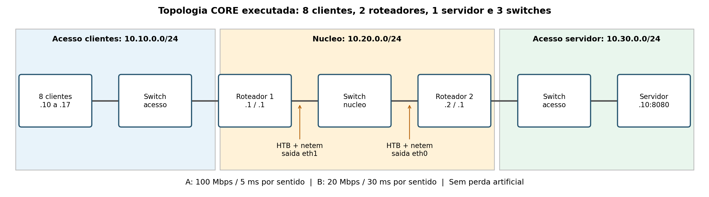
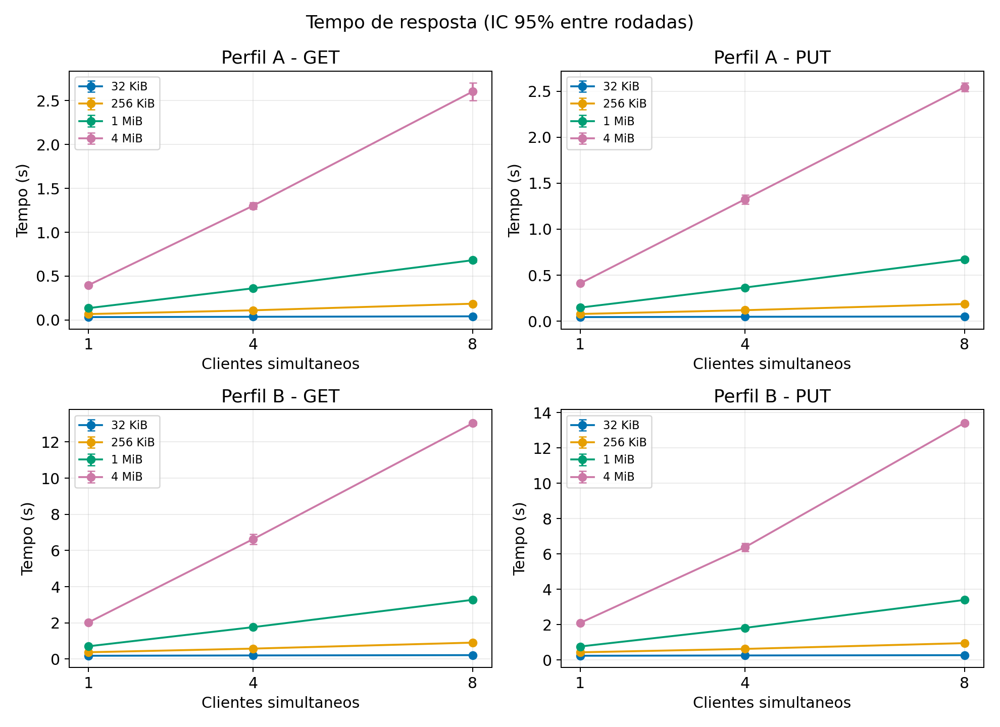
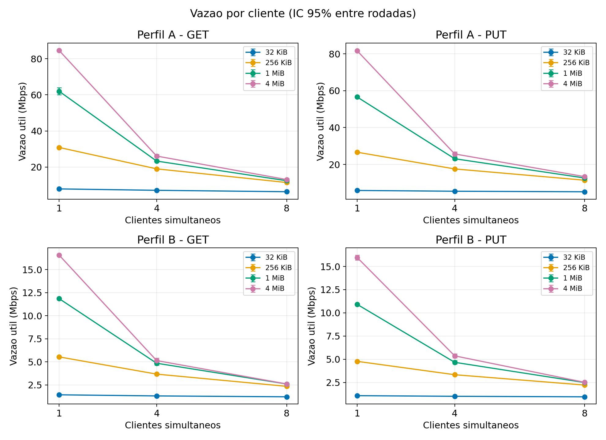
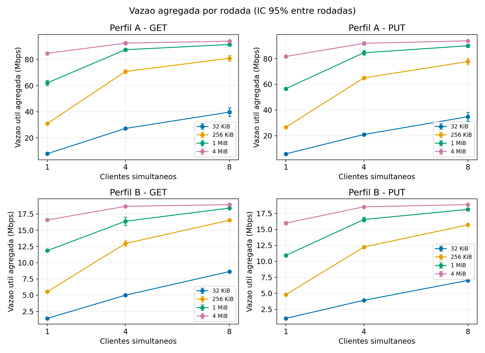
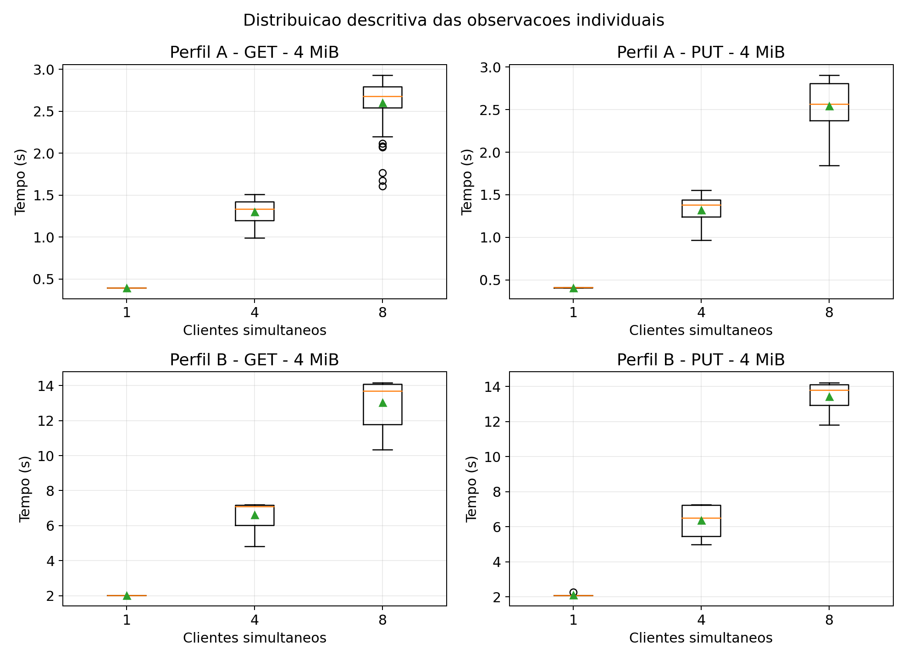
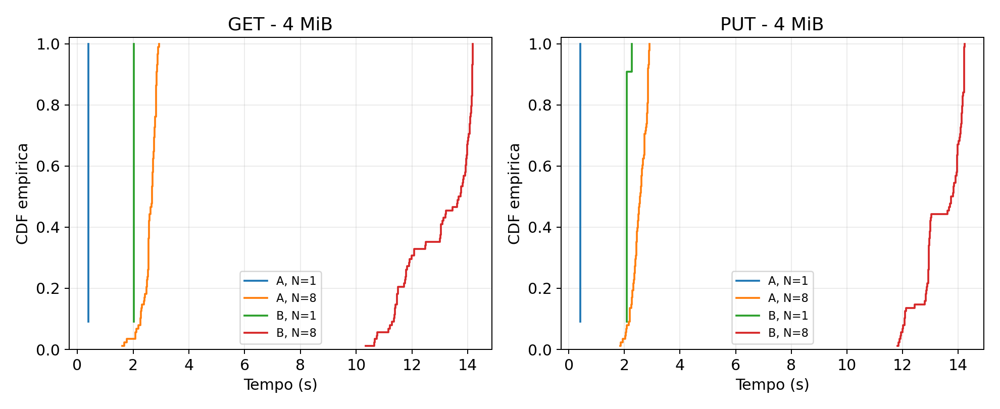

# Introdução

Este trabalho implementa transferências binárias sobre TCP \cite{tcp} em C/Linux e investiga como tamanho de arquivo, concorrência e perfil de rede afetam o tempo de resposta e a vazão útil. A Parte 1 compreende cliente, servidor e testes de correção; a Parte 2 compreende topologia CORE, validação, experimento, telemetria e análise estatística. Os artefatos estão separados em `parte1/` e `parte2/`.

A coleta principal foi concluída: **528 rodadas, 48 configurações, 11 repetições por configuração e 2288 transferências**, todas com status de sucesso e SHA-256 correspondente. O piloto adicional contém quatro rodadas e 16 transferências e é analisado separadamente. O intervalo registrado da campanha principal foi de 2026-11-05T17:05:21Z a 2026-11-05T17:22:04Z, em UTC. Não se produziram itens da Parte 3.

# Parte 1: implementação e auditoria

## Base funcional e preservação

Conforme a orientação do usuário, a referência funcional é `tcp_client.c` e `tcp_server.c`, originalmente em `1_TCPTrasmission/client/` e `1_TCPTrasmission/server/`. Os arquivos chamados `tcp.c` não são a base funcional e não são necessários para a entrega. Os originais restantes foram organizados em `parte1/originais/1_TCPTrasmission/`, sem alteração de conteúdo. Os hashes dos fontes funcionais estão preservados nas evidências da Parte 1.

As versões finais encontram-se em `parte1/src/tcp_client.c`, `tcp_server.c` e `protocol.h`. A auditoria considerou o escopo fornecido pelo usuário; um PDF adicional do enunciado não foi disponibilizado. O cliente final usa argumentos de linha de comando para permitir automação; os originais interativos foram preservados.

| Problema na referência funcional | Correção final |
| --- | --- |
| Contador de clientes sem sincronização | Oito trabalhadores OpenMP dedicados, sem contador compartilhado |
| Upload truncava o destino antes de terminar | Temporário exclusivo e rename atômico após fechamento bem-sucedido |
| PUTs para o mesmo nome interferiam entre si | Cada transferência usa seu temporário; última publicação concluída vence |
| GET podia observar conteúdo em escrita | Descritor mantém a versão publicada; PUT troca o inode ao concluir |
| Echo sem LF bloqueava a leitura esperada | Echo inclui a quebra de linha |
| Erros podiam resultar em saída de sucesso | Status JSON de erro e código de retorno não zero |
| Validações de nome divergentes | Rotinas compartilhadas de validação e enquadramento |
| Falta de limites de espera | Timeouts de socket e conexão, mais watchdog do executor |

## Contrato TCP e arquivos binários

Cada comando é uma linha ASCII encerrada em LF; o corpo contém exatamente o tamanho anunciado, podendo incluir qualquer byte. Nomes remotos simples têm até 255 caracteres e aceitam letras ASCII, dígitos, ponto, hífen e sublinhado, exceto ponto e dois pontos consecutivos isolados. Caminhos, espaços, CR e NUL não são aceitos. Tamanhos usam somente dígitos decimais, sem sinal, até 1 GiB.

```text
GET nome.bin\n
<- OK tamanho\n + exatamente tamanho bytes
   ou ERR motivo\n

PUT nome.bin tamanho\n
<- READY\n
-> exatamente tamanho bytes
<- OK\n ou ERR motivo\n
```

Uma conexão admite comandos sucessivos, inclusive quando cabeçalhos e payloads chegam juntos. QUIT encerra a conexão. GET/PUT malformados recebem ERR; outros textos recebem echo com LF. Se uma falha comprometer o enquadramento, a conexão é encerrada. O cliente automatizado executa uma operação por processo e recebe IPv4, porta, operação, nome remoto e caminho local.

`send_all` e `recv_exact` repetem operações parciais e EINTR. `MSG_NOSIGNAL` evita terminar o processo por SIGPIPE. A leitura da linha não consome os bytes seguintes do arquivo. GET transmite somente o tamanho anunciado. Resultados de leitura, escrita e fechamento são verificados. GET rejeita symlinks e arquivos não regulares; PUT substitui o nome de destino sem seguir um eventual symlink.

## OpenMP, sobrescrita e falhas

Oito trabalhadores OpenMP \cite{openmp} executam accept e atendimento independentemente, com ajuste dinâmico desativado. Cada um atende uma conexão por vez. Conexões adicionais podem aguardar no backlog de 128, sujeito ao kernel. Essa organização remove a corrida do contador e evita que o laço bloqueante de aceitação seja executado em um ponto de escalonamento de tarefas.

PUT grava um temporário criado por mkstemp no diretório de armazenamento. Após fclose bem-sucedido, rename publica o arquivo completo e substitui o existente, inclusive por arquivo vazio. GET usa um descritor da versão aberta, e o cliente grava o download em temporário antes de substituir seu destino. Uma transferência interrompida preserva a versão anterior. Não há garantia de durabilidade após queda de energia: o protocolo não executa fsync no arquivo e no diretório. Alterações externas diretas no conteúdo publicado ficam fora do contrato.

Sockets têm timeout de 15 segundos por espera; a conexão usa poll não bloqueante. Na campanha, timeout externo de 55 segundos limita o cliente e um watchdog de 60 segundos limita o comando do nó. A proteção não constitui uma defesa completa contra clientes que enviem bytes lentamente. Não há autenticação ou criptografia neste protótipo acadêmico.

## Testes de correção

A compilação usa GCC, C11, OpenMP, O2, `-Wall -Wextra -Wpedantic -Werror` e offsets de arquivo de 64 bits. Foram executados **11 testes de integração normalmente e os mesmos 11 sob interposição LD_PRELOAD**, com todos aprovados. A interposição força send de até 4093 bytes, recv de até 257 bytes e EINTR periódico, exercitando os loops dos programas reais.

A suíte cobre arquivos de 0, 1, 1023, 1024, 4096, 32768, 262144, 1048576 e 4194304 bytes, GET/PUT e SHA-256; sobrescrita com aumento e redução; cabeçalhos fragmentados; payload binário e comandos encadeados; upload interrompido; oito respostas READY antes de enviar qualquer payload; oito PUTs concorrentes para o mesmo nome; sintaxe inválida e arquivo ausente; symlink e FIFO; GET durante PUT; download truncado; cabeçalho excessivo; recuperação e timeout ocioso. O teste de oito READY comprova simultaneidade independentemente do tempo total da suíte.

As evidências da Parte 1 ficam no diretório `parte1/evidencias/`. O arquivo `compilacao.log` registra a compilação; `testes.log` registra a execução normal; o log de interposição é `testes_io_parcial.log`. O servidor também mantém seu log de teste. Três testes adicionais verificam a análise: IC com unidade rodada, ausência de IC com uma única rodada e exclusão de tentativas incompletas ou não confirmadas.

# Parte 2.1: ambiente e topologia CORE

## Ambiente real

O CORE \cite{core} já instalado foi localizado no Docker, no container privilegiado `core`, com CORE 9.2.0 e Python 3.10 em `/opt/core/venv`. O host usa Ubuntu 22.04/WSL2 e kernel Linux 6.18.33.2-microsoft-standard-WSL2. Todos os nós compartilham o kernel e os recursos do host. CPU, memória, compilador, imagem Docker e versões estão registrados em `parte2/evidencias/ambiente.log`.

A validação final usou iperf 3.22 \cite{iperf}, compilado de fonte oficial. Em tentativas preliminares com iperf 3.9 foi observado um intervalo de encerramento de aproximadamente dez segundos com pouco tráfego, que reduzia a média final em algumas execuções; esses ensaios não entraram na campanha. Ajustes de filas e atualização da ferramenta precederam a validação final, sem isolamento da causa específica do comportamento anterior. Os JSON entregues correspondem às validações finais, não a valores corrigidos manualmente.

A coleta permaneceu armazenada no diretório isolado `/tmp/redest1-work` do container. Após a reorganização do workspace, CSV, journals, fontes executados e logs foram recuperados diretamente desse diretório. O executor original usado nas medições está preservado em `parte2/evidencias/codigo_executado/`; a versão em `parte2/core/` adapta os caminhos à separação por partes.

## Redes de acesso e núcleo

{width=98%}

| Elemento | Endereçamento |
| --- | --- |
| Acesso cliente | 10.10.0.0/24; clientes 10.10.0.10 a 10.10.0.17 |
| Roteador 1 | eth0 10.10.0.1; eth1 10.20.0.1 |
| Núcleo | 10.20.0.0/24, com switch CORE |
| Roteador 2 | eth0 10.20.0.2; eth1 10.30.0.1 |
| Acesso servidor | 10.30.0.0/24; servidor 10.30.0.10:8080 |

Os dois roteadores têm encaminhamento IP habilitado e rotas estáticas. Clientes e servidor usam seus roteadores de acesso como gateway padrão. Os acessos Ethernet virtuais não recebem limitação artificial adicional. O recurso compartilhado é modelado nas saídas para o núcleo: roteador1:eth1 no sentido cliente-servidor e roteador2:eth0 no sentido servidor-cliente.

Cada saída usa HTB, taxa e teto iguais, burst de 16 KiB, e fila filha netem com atraso fixo e limite de 10000 pacotes. Não foi configurada perda artificial. TSO, GSO e GRO foram desativados; o controle de congestionamento TCP é CUBIC. A fila ainda pode descartar pacotes por congestionamento, por isso os contadores reais de qdisc foram preservados nas validações e no estado final disponível.

| Perfil proposto | Taxa por sentido | Atraso por direção | RTT nominal |
| --- | --- | --- | --- |
| A | 100 Mbps | 5 ms | 10 ms |
| B | 20 Mbps | 30 ms | 60 ms |

São dois cenários controlados de conectividade, sem pretensão de representar universalmente tecnologias de acesso. O ping cruza um atraso na ida e outro na volta. `core/perfis.json` registra parâmetros; `core/run_experiments.py` é a topologia executável completa. O XML preserva o desenho e os enlaces, devendo ser usado com o script para reaplicar rotas e shaping.

## Validação de conectividade e gargalo

Foram executados ping com dez pacotes, traceroute ICMP e iperf nos dois sentidos. O iperf usa uma conexão TCP, cinco segundos medidos, um segundo omitido e janela solicitada de 256 KiB. A verificação automática exige vazão recebida entre 65% e 120% do teto, RTT médio entre 80% do nominal e nominal mais 15 ms e zero perda no ping.

| Perfil | Mbps cfg. | Atraso ms | Ping médio ms | Ida Mbps | Volta Mbps | Perda |
| --- | --- | --- | --- | --- | --- | --- |
| A | 100 | 5 | 11.817 | 95.348 | 94.995 | 0/10 |
| B | 20 | 30 | 60.707 | 19.206 | 19.085 | 0/10 |


As colunas de vazão são valores recebidos do iperf em Mbps; perda indica pacotes perdidos/enviados no ping. O traceroute confirmou os saltos 10.10.0.1, 10.20.0.2 e 10.30.0.10. Os logs integrais estão em `parte2/evidencias/ping_*.log`, `traceroute_*.log`, `iperf_*_*.json` e `tc_*.json`.

O piloto executou GET e PUT em A e B com 256 KiB e quatro clientes: quatro rodadas, 16 transferências e todos os hashes corretos. `evidencias/piloto.csv` e seu journal preservam esse ensaio, que não entra nas estatísticas principais.

# Parte 2.2: planejamento experimental

Os objetos de **32 KiB e 256 KiB** representam tamanhos de miniaturas e imagens comprimidas de uma aplicação Web; **1 MiB e 4 MiB** representam anexos ou objetos de uma aplicação de armazenamento em nuvem. Os dados são binários sintéticos determinísticos: o propósito é contrastar custo fixo de comunicação e transmissão de payload. Não se reproduzem HTTP, TLS, codecs, distribuições reais de usuários ou uma aplicação comercial.

A matriz fatorial cruza dois perfis, duas operações, quatro tamanhos e concorrências de 1, 4 e 8 clientes. Cada combinação tem 11 repetições: $2\times2\times4\times3\times11=528$ rodadas e 2288 transferências individuais. GET e PUT são executados em rodadas separadas. Dentro de cada bloco de repetição, as 48 combinações são embaralhadas com semente 20261105. A matriz preserva a ordem executada.

As 11 repetições permitem observar dispersão dentro do prazo, sem garantir previamente uma precisão estatística específica. Não foram excluídos outliers nem descartadas primeiras transferências da campanha. Piloto e tráfego de validação são separados. O cache de arquivos não foi limpo; os resultados descrevem dados previamente preparados, sem controle de disco frio.

# Parte 2.3: execução, telemetria e retomada

Cada cliente é um processo real em um nó CORE distinto. O executor fornece uma mesma data futura no relógio monotônico, 150 ms à frente. Os processos aguardam essa barreira antes de iniciar a conexão TCP. Início e duração são medidos no programa C com CLOCK_MONOTONIC; o relógio de parede serve apenas para datar a coleta em UTC. Os instantes são comparáveis porque os nós compartilham o kernel.

O intervalo inclui conexão, comandos, negociação READY quando aplicável, payload e conclusão local. PUT termina após receber OK da publicação no servidor; GET termina após fechamento e rename no cliente. Geração de dados, criação do processo, espera da barreira e verificação SHA-256 ficam fora desse intervalo. Os hashes de origem e destino são registrados para cada transferência.

Todas as rodadas concorrentes apresentaram interseção temporal positiva: a menor foi **33.313 ms**, e o maior desvio entre inícios foi **2.038 ms**. Isso complementa o teste de oito READY e comprova que os clientes da campanha não foram serializados. Cada PUT da campanha usa um nome remoto por cliente, evitando disputa de nomes como fator experimental.

A vazão útil individual é $8B/(10^6T)$, em Mbps, sem contabilizar cabeçalhos e comandos. A vazão agregada divide a soma de payloads pelo intervalo entre o primeiro início e a última conclusão da rodada, sem simplesmente somar vazões individuais com durações diferentes.

O CSV registra perfil, operação, tamanho, concorrência, repetição, cliente, tentativa, início monotônico, duração, vazão, bytes, status, hashes esperado/observado, erro, desvio de início, sobreposição, duração da rodada, vazão agregada e horário UTC. O executor sincroniza o CSV em disco antes de confirmar a tentativa no journal JSONL. Uma rodada só é aproveitada se a tentativa estiver confirmada e todos os clientes previstos estiverem presentes; tentativas incompletas ou substituídas são excluídas sem serem tratadas como conclusão.

A retomada foi exercitada encerrando o executor após duas rodadas e iniciando novamente a campanha. As tentativas originais `ed8393b2ed98` e `6833dbccb620` foram preservadas exatamente uma vez. Uma nova execução após as 528 rodadas também retornou `No pending rounds`, registrado em `evidencias/retomada_concluida.log`. Isso valida checkpoints íntegros; não é um teste de queda de energia, corrupção arbitrária ou interrupção no meio de uma escrita de arquivo. Falhas com status terminal permanecem como medições de falha e não são apagadas por repetição automática.

# Parte 2.4: estatística e resultados

## Unidade experimental e intervalos de confiança

O cliente é unidade de observação; a **rodada** é unidade de repetição. Clientes de uma mesma rodada compartilham enlace, filas e servidor, portanto 88 observações com oito clientes não são consideradas 88 repetições independentes.

A média de tempo e vazão usa médias de clientes bem-sucedidos em cada rodada. O IC de 95% usa Student entre as $m$ médias de rodada: $\bar{x}\pm t_{0{,}975,m-1}s_{\mathrm{rodadas}}/\sqrt{m}$. Nesta campanha completa, $m=11$ em cada configuração, com dez graus de liberdade. A vazão agregada tem uma observação por rodada. Mediana e desvio padrão entre clientes são descritivos da distribuição individual; o CSV também apresenta desvio entre médias de rodada. O IC da mediana usa bootstrap percentil de 3000 reamostragens de rodadas inteiras, com semente fixa, preservando os clientes agrupados.

Sucesso e falha são calculados por observação e por rodada. Desempenho considera apenas sucessos, com essa seleção explícita. Uma única rodada não recebe IC estimado. Os intervalos são marginais, sem ajuste para comparações múltiplas, e a abordagem não elimina possível dependência temporal residual entre rodadas do mesmo host.

## Completude e desempenho observado

Foram verificados **528/528 rodadas, 2288/2288 sucessos, taxa de sucesso de 100% e taxa de falha de 0%**. As 48 configurações têm 11 repetições. Nenhuma observação foi excluída por tentativa incompleta ou substituída. Zero falhas na amostra não garante probabilidade de falha nula em outros contextos.

A tabela apresenta objetos de 4 MiB: tempo médio por cliente e IC entre rodadas, vazão individual média e vazão agregada média. Todas as médias e IC completos estão em `resultados_resumidos.csv`.

| Perfil | Op. | N | Tempo s | IC 95% s | Mbps/cliente | Mbps agregado |
| --- | --- | --- | --- | --- | --- | --- |
| A | GET | 1 | 0.396 | 0.396 a 0.397 | 84.638 | 84.638 |
| A | GET | 4 | 1.301 | 1.264 a 1.339 | 26.092 | 92.431 |
| A | GET | 8 | 2.602 | 2.502 a 2.702 | 13.060 | 93.947 |
| A | PUT | 1 | 0.411 | 0.409 a 0.413 | 81.678 | 81.678 |
| A | PUT | 4 | 1.324 | 1.273 a 1.375 | 25.681 | 91.924 |
| A | PUT | 8 | 2.543 | 2.495 a 2.591 | 13.358 | 93.859 |
| B | GET | 1 | 2.024 | 2.023 a 2.024 | 16.582 | 16.582 |
| B | GET | 4 | 6.626 | 6.341 a 6.912 | 5.134 | 18.679 |
| B | GET | 8 | 13.030 | 12.922 a 13.138 | 2.599 | 18.947 |
| B | PUT | 1 | 2.102 | 2.065 a 2.139 | 15.970 | 15.970 |
| B | PUT | 4 | 6.380 | 6.159 a 6.602 | 5.364 | 18.527 |
| B | PUT | 8 | 13.422 | 13.333 a 13.510 | 2.509 | 18.869 |


{width=98%}

{width=98%}

{width=98%}

## Objetos pequenos, distribuição e CDF

| Perfil | Op. | N | Tempo s (32 KiB) | Mbps/cliente |
| --- | --- | --- | --- | --- |
| A | GET | 1 | 0.0333 | 7.883 |
| A | GET | 8 | 0.0421 | 6.324 |
| A | PUT | 1 | 0.0448 | 5.862 |
| A | PUT | 8 | 0.0515 | 5.149 |
| B | GET | 1 | 0.1847 | 1.419 |
| B | GET | 8 | 0.2192 | 1.203 |
| B | PUT | 1 | 0.2448 | 1.071 |
| B | PUT | 8 | 0.2775 | 0.949 |


A tabela de 32 KiB mostra a relevância do custo de conexão e negociação em relação ao payload. Os gráficos de distribuição e CDF descrevem observações individuais, sem pressupor independência entre clientes de uma rodada.

{width=98%}

{width=98%}

# Discussão

## Gargalo compartilhado e saturação

Com oito clientes e arquivos de 4 MiB, a vazão agregada ficou próxima de 94 Mbps no perfil A e de 19 Mbps no B. Ao passar de quatro para oito clientes, o ganho agregado foi pequeno, enquanto o tempo individual aumentou. A tabela quantifica esse comportamento.

| Perfil | Op. | Tempo 8/1 | Agregado 8/4 | Teto com N=8 |
| --- | --- | --- | --- | --- |
| A | GET | 6.56 | 1.016 | 93.9% |
| A | PUT | 6.19 | 1.021 | 93.9% |
| B | GET | 6.44 | 1.014 | 94.7% |
| B | PUT | 6.38 | 1.018 | 94.3% |


A proximidade das razões agregadas de um, junto com o aumento de tempo e a redução de vazão individual, é compatível com saturação do gargalo compartilhado. Não é possível determinar seu ponto exato com apenas três níveis de concorrência. O resultado não demonstra por si só saturação de CPU ou disco: não houve instrumentação contínua desses recursos durante cada rodada.

No perfil A, GET de 4 MiB passou de aproximadamente 0,396 s com um cliente para 2,602 s com oito; no B, de 2,024 s para 13,030 s. Para PUT, os valores foram aproximadamente 0,411 s e 2,543 s em A, contra 2,102 s e 13,422 s em B. Esses valores vêm das médias das rodadas, e não de uma previsão teórica de transmissão.

## GET versus PUT e perfil A versus B

A tabela mostra razões de médias de tempo; uma razão PUT/GET maior que um indica PUT mais demorado naquela célula. São comparações descritivas, sem teste pareado adicional ou IC específico das razões.

| KiB | N | PUT/GET A | PUT/GET B | B/A GET | B/A PUT |
| --- | --- | --- | --- | --- | --- |
| 32 | 1 | 1.343 | 1.325 | 5.543 | 5.469 |
| 32 | 8 | 1.222 | 1.266 | 5.202 | 5.387 |
| 4096 | 1 | 1.036 | 1.039 | 5.104 | 5.117 |
| 4096 | 8 | 0.977 | 1.030 | 5.007 | 5.279 |


PUT inclui a espera por READY e pela confirmação final; GET inclui o cabeçalho de resposta e conclusão da gravação local. Esses custos ajudam a interpretar os dados, mas não isolam causas. Algumas diferenças entre operações mudam de direção conforme a concorrência e o tamanho, portanto os dados não sustentam afirmar que uma operação é universalmente mais rápida.

B combina taxa cinco vezes menor e RTT nominal seis vezes maior. As razões B/A refletem o perfil completo; a matriz não isola os efeitos individuais de taxa e latência. Objetos pequenos ficam mais sujeitos aos custos fixos das fases do protocolo; objetos grandes sustentam maior uso do gargalo agregado. Separar os dois fatores exigiria variar somente um deles por vez em um experimento adicional.

# Limitações

Os resultados se referem a uma única máquina WSL/Docker, versão de kernel, imagem e implementação, com CPU, memória, armazenamento e escalonador compartilhados. Não há reserva de CPU ou afinidade fixa. Os acessos são Ethernet virtuais; os perfis são aplicados no gargalo do núcleo. Atraso fixo e ausência de perda artificial não equivalem a uma rede física com jitter, mobilidade ou perda de rádio.

A fila de 10000 pacotes pode acomodar rajadas e não representa necessariamente um equipamento residencial. Há snapshots de qdisc, sem captura contínua de pacotes ou telemetria por fila de cada rodada; por isso não se atribui cada observação extrema a uma causa específica. Não foram isolados cache de página, disco frio, TLS, justiça entre aplicações, longa duração ou hash dentro do protocolo. Onze rodadas oferecem uma estimativa limitada de variabilidade, e os IC não corrigem comparações múltiplas.

A retomada foi validada com checkpoint íntegro, sem simulação de queda física de energia. Os logs finais e dados foram preservados no Docker e recuperados após a reorganização do workspace; diagnósticos de tentativas preliminares não integram os resultados principais. O relatório não identifica integrantes ou contribuições individuais porque essas informações não foram fornecidas.

# Conclusões

A Parte 1 compila com avisos tratados como erros, transfere arquivos binários e vazios, sobrescreve destinos e preserva versões anteriores em transferências interrompidas. Os testes cobriram oito atendimentos simultâneos, conflitos de nomes e operações parciais de socket. A Parte 2 utilizou o CORE instalado no Docker para executar topologia roteada, dois perfis validados e a campanha completa de 528 rodadas.

A coleta produziu 2288 transferências corretas. Para objetos grandes, a vazão agregada se aproximou do limite compartilhado e cresceu pouco entre quatro e oito clientes, enquanto o tempo por cliente aumentou. A análise de incerteza usa rodadas, respeitando a dependência interna entre clientes. Fontes, matriz, dados, estatísticas, figuras e logs permitem inspecionar, reproduzir e defender essas conclusões sem resultados inventados.

# Reprodução e organização da entrega

A raiz contém apenas o índice e as duas partes. `parte1/` contém fontes, Makefile, testes, originais e evidências de correção. `parte2/` contém CORE, scripts, matriz, CSV, gráficos, relatório LaTeX/Markdown/PDF e evidências experimentais. Cada parte possui seu README e STATUS.

No Linux, instale GCC/make, Docker, Python 3, NumPy, SciPy, Matplotlib, Pandoc e TeX Live com suporte a português. A imagem `core` deve conter CORE 9.2.0. A partir da raiz:

```bash
make -C parte1
bash parte1/scripts/verify.sh
sudo bash parte2/scripts/run_docker.sh pilot
sudo bash parte2/scripts/run_docker.sh main
python3 parte2/scripts/check_outputs.py
python3 parte2/scripts/analyze.py
python3 parte2/scripts/plot_topology.py
python3 parte2/scripts/build_report.py
```

O executor usa o container `core` e `/tmp/redest1-work` por padrão. A campanha entregue está concluída nesse diretório e sua retomada não repete medições confirmadas. Para uma nova campanha, escolha outro CORE_WORKDIR e preserve uma cópia dos resultados entregues antes de copiar novos dados. `scripts/sync_docker.sh` conserva CSV e journal juntos; a análise só aproveita rodadas completas.

Após a separação das pastas, o fluxo de reprodução também foi executado em um diretório Docker novo. Recompilou os programas e o iperf, reconstruiu e validou a topologia e concluiu outras quatro rodadas de piloto (16 transferências corretas). Essas observações ficam em `evidencias/reprodutibilidade/` e não foram somadas à campanha principal.

O LaTeX entregue independe de Pandoc para recompilar. Dentro de `parte2/`, com a pasta `graficos/` ao lado do fonte:

```bash
pdflatex -interaction=nonstopmode -halt-on-error relatorio_final.tex
pdflatex -interaction=nonstopmode -halt-on-error relatorio_final.tex
pdflatex -interaction=nonstopmode -halt-on-error relatorio_final.tex
```

Pandoc é usado apenas para regenerar o fonte a partir do Markdown e dos dados. O gerador Python do relatório cria o fonte e compila o PDF. Os arquivos intermediários ficam na pasta de compilação.

# Apêndice: estatísticas das 48 configurações

Tamanho em KiB, N clientes, R rodadas, tempos em segundos e vazão útil em Mbps por cliente. DP descreve a dispersão individual, não o erro padrão usado no IC. IC das médias e medianas, taxas e vazão agregada estão no CSV completo.


| Perfil | Op. | KiB | N | R | Média s | Mediana s | DP s | Mbps |
| --- | --- | --- | --- | --- | --- | --- | --- | --- |
| A | GET | 32 | 1 | 11 | 0.033 | 0.033 | 0.002 | 7.883 |
| A | GET | 32 | 4 | 11 | 0.037 | 0.037 | 0.002 | 7.104 |
| A | GET | 32 | 8 | 11 | 0.042 | 0.041 | 0.006 | 6.324 |
| A | GET | 256 | 1 | 11 | 0.068 | 0.068 | 0.001 | 30.868 |
| A | GET | 256 | 4 | 11 | 0.111 | 0.110 | 0.007 | 19.004 |
| A | GET | 256 | 8 | 11 | 0.186 | 0.189 | 0.020 | 11.427 |
| A | GET | 1024 | 1 | 11 | 0.136 | 0.133 | 0.007 | 62.025 |
| A | GET | 1024 | 4 | 11 | 0.361 | 0.366 | 0.023 | 23.320 |
| A | GET | 1024 | 8 | 11 | 0.681 | 0.692 | 0.055 | 12.423 |
| A | GET | 4096 | 1 | 11 | 0.396 | 0.397 | 0.001 | 84.638 |
| A | GET | 4096 | 4 | 11 | 1.301 | 1.333 | 0.138 | 26.092 |
| A | GET | 4096 | 8 | 11 | 2.602 | 2.679 | 0.264 | 13.060 |
| A | PUT | 32 | 1 | 11 | 0.045 | 0.044 | 0.001 | 5.862 |
| A | PUT | 32 | 4 | 11 | 0.048 | 0.048 | 0.004 | 5.442 |
| A | PUT | 32 | 8 | 11 | 0.052 | 0.050 | 0.006 | 5.149 |
| A | PUT | 256 | 1 | 11 | 0.079 | 0.078 | 0.001 | 26.614 |
| A | PUT | 256 | 4 | 11 | 0.120 | 0.120 | 0.007 | 17.549 |
| A | PUT | 256 | 8 | 11 | 0.187 | 0.192 | 0.024 | 11.422 |
| A | PUT | 1024 | 1 | 11 | 0.148 | 0.147 | 0.002 | 56.586 |
| A | PUT | 1024 | 4 | 11 | 0.366 | 0.366 | 0.030 | 23.084 |
| A | PUT | 1024 | 8 | 11 | 0.671 | 0.675 | 0.060 | 12.624 |
| A | PUT | 4096 | 1 | 11 | 0.411 | 0.411 | 0.003 | 81.678 |
| A | PUT | 4096 | 4 | 11 | 1.324 | 1.382 | 0.146 | 25.681 |
| A | PUT | 4096 | 8 | 11 | 2.543 | 2.565 | 0.270 | 13.358 |
| B | GET | 32 | 1 | 11 | 0.185 | 0.185 | 0.001 | 1.419 |
| B | GET | 32 | 4 | 11 | 0.202 | 0.203 | 0.007 | 1.299 |
| B | GET | 32 | 8 | 11 | 0.219 | 0.219 | 0.017 | 1.203 |
| B | GET | 256 | 1 | 11 | 0.379 | 0.379 | 0.001 | 5.535 |
| B | GET | 256 | 4 | 11 | 0.579 | 0.587 | 0.064 | 3.664 |
| B | GET | 256 | 8 | 11 | 0.910 | 0.942 | 0.104 | 2.339 |
| B | GET | 1024 | 1 | 11 | 0.708 | 0.707 | 0.002 | 11.856 |
| B | GET | 1024 | 4 | 11 | 1.765 | 1.801 | 0.244 | 4.846 |
| B | GET | 1024 | 8 | 11 | 3.275 | 3.274 | 0.356 | 2.594 |
| B | GET | 4096 | 1 | 11 | 2.024 | 2.024 | 0.001 | 16.582 |
| B | GET | 4096 | 4 | 11 | 6.626 | 7.101 | 0.734 | 5.134 |
| B | GET | 4096 | 8 | 11 | 13.030 | 13.697 | 1.211 | 2.599 |
| B | PUT | 32 | 1 | 11 | 0.245 | 0.245 | 0.001 | 1.071 |
| B | PUT | 32 | 4 | 11 | 0.261 | 0.262 | 0.007 | 1.005 |
| B | PUT | 32 | 8 | 11 | 0.277 | 0.278 | 0.017 | 0.949 |
| B | PUT | 256 | 1 | 11 | 0.439 | 0.439 | 0.001 | 4.773 |
| B | PUT | 256 | 4 | 11 | 0.632 | 0.628 | 0.039 | 3.331 |
| B | PUT | 256 | 8 | 11 | 0.959 | 0.999 | 0.104 | 2.215 |
| B | PUT | 1024 | 1 | 11 | 0.768 | 0.768 | 0.002 | 10.917 |
| B | PUT | 1024 | 4 | 11 | 1.821 | 1.831 | 0.203 | 4.668 |
| B | PUT | 1024 | 8 | 11 | 3.404 | 3.597 | 0.320 | 2.487 |
| B | PUT | 4096 | 1 | 11 | 2.102 | 2.085 | 0.055 | 15.970 |
| B | PUT | 4096 | 4 | 11 | 6.380 | 6.495 | 0.876 | 5.364 |
| B | PUT | 4096 | 8 | 11 | 13.422 | 13.787 | 0.776 | 2.509 |
